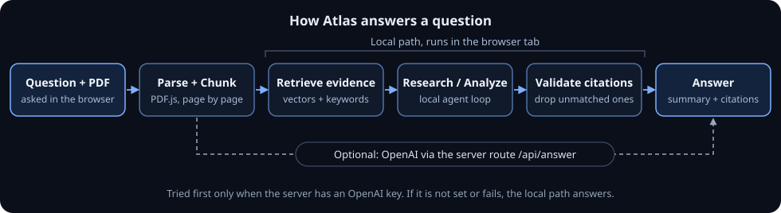

<p align="center">
  
</p>

<div align="center">

# Atlas

**Privacy-first autonomous research agent that runs in your browser.**

Ask a question, attach a PDF, and get a concise, evidence-backed answer with citations.

[Live Demo](https://atlas-research-ruby.vercel.app/) · [GitHub](https://github.com/shahil5z/atlas)

</div>

<p align="center">
  
  <br>
  <sub>Live run on the deployed app: a 13-page PDF, answered in 5.44 s with 4 citations.</sub>
</p>

## What is Atlas?

Atlas is a research assistant for your own documents. You ask a question, optionally attach a text PDF, and Atlas reads it page by page, finds the passages that matter, and writes a short answer: one direct sentence first, then a few headings with brief bullets tied to the pages they came from.

Atlas's own research pipeline runs in the browser tab. PDF parsing, chunking, embeddings, vector search, and a small local language model all run on your device, with no account, no database, and no analytics.

When the server is configured with an OpenAI key, Atlas tries a hosted answer first and falls back to the local pipeline automatically. Without a key, every answer comes from the local model.

It works best with ordinary text PDFs such as reports, papers, notes, study plans, and resumes, and it can also answer general questions without a document.

## Highlights

- In-browser PDF parsing with PDF.js; scripts inside the PDF never run
- Page-aware chunks, so every citation points to a real page
- Hybrid retrieval: local embeddings plus keyword scoring over an in-memory index
- A small agent loop that plans, researches, analyzes, critiques, and writes
- Citations checked against retrieved passages; unsupported ones are dropped
- A quality gate that repairs weak answers or says plainly when it cannot answer
- Document text is treated as untrusted, so instructions inside a PDF are not followed
- WebGPU when available, WASM otherwise
- Optional OpenAI answers, with automatic fallback to the local model

## How it works

1. **Ask.** Type a question and, if you like, attach a text PDF.
2. **Parse.** PDF.js extracts the text in the browser, page by page.
3. **Chunk.** Each page is split into small passages that keep their page number.
4. **Retrieve.** Passages are embedded locally and the most relevant ones are found for the question.
5. **Research.** Atlas answers from the document's structure when it can, otherwise the local agent loop reasons over the evidence.
6. **Verify and answer.** Citations are checked, weak answers are repaired or rejected, and the final answer is shown.

If the server has an OpenAI key, step 4 onward is replaced by a hosted draft from the extracted page text. Atlas uses the local path whenever that request is unavailable or fails.

<p align="center">
  
</p>

## Tech stack

- **App:** Next.js 16, React 19, TypeScript, Tailwind CSS 4
- **PDF:** PDF.js (`pdfjs-dist`)
- **Local AI:** Transformers.js (`@huggingface/transformers`) on ONNX Runtime with WebGPU or WASM
- **Models:** `all-MiniLM-L6-v2` for embeddings, `SmolLM2-360M-Instruct` for local answers
- **Hosted answers (optional):** OpenAI Chat Completions via a Next.js route
- **Quality:** Zod schemas, Vitest, ESLint
- **Hosting:** Vercel

## Privacy

- Your question, PDF, extracted text, vectors, and answer live only in the tab's memory. Nothing is saved to browser storage or a database, and refreshing the page clears the session.
- The PDF file itself is never uploaded.
- **With an OpenAI key on the server:** the question, file name, and extracted page text are sent to the app's `/api/answer` route and from there to OpenAI. The key stays on the server.
- **Local path:** research stays in the tab. The first run downloads model files from Hugging Face, which the browser may cache.
- Atlas does not search the web.

Full details are in [docs/privacy.md](docs/privacy.md).

## Current limitations

- Text PDFs only. There is no OCR, so scanned pages cannot be read.
- Large PDFs are rejected, and the OpenAI path only sees the first part of a long document.
- The local model is small: slower than OpenAI, device dependent, and it can miss details.
- The first local run downloads a few hundred MB of model files.
- The result screen shows a citation count, not yet inline markers or a source list.

## Documentation

- [Architecture](docs/architecture.md): pipeline, retrieval, agents, and generation
- [Privacy](docs/privacy.md): what stays in the tab and what can use the network
- [Evaluation](docs/evaluation.md): fixtures, metrics, and how to run them
- [Licenses](docs/licenses.md): models and third-party libraries

## Run locally

Requires Node.js and npm.

```bash
npm ci
npm run dev
```

Open http://localhost:3000. The local model needs no key; to enable hosted answers, set `OPENAI_API_KEY` in `.env.local`.

## Evaluation

Atlas scores retrieval, citations, structured output, and the agent loop against versioned, synthetic fixtures with `npm run eval`. These numbers show the code behaves as designed, not live answer quality; see [docs/evaluation.md](docs/evaluation.md).

## Author

Built by **Shohrab Haque Shahil** · [GitHub](https://github.com/shahil5z) · [LinkedIn](https://www.linkedin.com/in/shohrab-haque) · [Website](https://shahil-personal.vercel.app)

## License

Model and library licenses are listed in [docs/licenses.md](docs/licenses.md).
