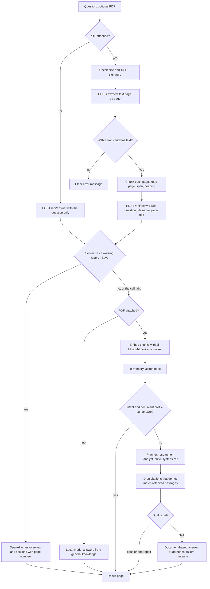

<p align="center">
  
</p>

<h1 align="center">Atlas</h1>

<p align="center">
  Ask a question, attach a PDF if you have one, and get a short answer.
</p>

<p align="center">
  <a href="https://atlas-research-ruby.vercel.app"><b>Open Atlas</b></a>
  ·
  <a href="https://github.com/shahil5z/atlas">Source on GitHub</a>
</p>

## What it is

Atlas is a research app that runs in your browser. You type a question. If you attach a text PDF, Atlas reads it page by page and answers from it. The answer starts with one direct sentence, then a few headings with short bullets.

There are two ways an answer gets written:

- **OpenAI**, when the server has a working `OPENAI_API_KEY`.
- **A small local model in your browser**, when there is no key, the key has expired, or the OpenAI request fails for any reason.

You never pick one. Atlas tries OpenAI first and quietly falls back to the local model.

Atlas works with normal text PDFs: reports, notes, papers, resumes, study plans, and similar files. A PDF can be up to 10 MB and 80 pages. Password-protected files are turned away. Scanned pages have no text to read, and Atlas does not run OCR.

## Live site and source

- Live site: [atlas-research-ruby.vercel.app](https://atlas-research-ruby.vercel.app)
- Source: [github.com/shahil5z/atlas](https://github.com/shahil5z/atlas)

## How it works, step by step

1. **You ask.** The question can be up to 4,000 characters. A PDF is optional.
2. **The file is checked.** Atlas rejects anything over 10 MB, and it reads the first bytes to make sure the file really starts with `%PDF-`. The file name and MIME type are only hints.
3. **PDF.js reads the text.** Parsing runs in the browser with a same-origin PDF.js worker. Scripts inside the PDF are never run, XFA forms are off, and PDF.js is set up not to fetch extra assets. Text is pulled out page by page. Atlas stops if the PDF has more than 80 pages or more than 320,000 characters of text, and it stops if no page has readable text (for example a scanned PDF).
4. **The text is split into chunks.** Each page is cut into pieces of about 800 characters with a 120 character overlap. Cuts prefer paragraph breaks, then line breaks, then sentence ends. A chunk never crosses a page, so every chunk knows its page number. Each chunk also keeps its character span, its order, and the nearest heading or section label when one can be found. The chunk id is built from the document id, page, order, and span. A PDF that would make more than 400 chunks is rejected.
5. **OpenAI gets the first try.** The browser posts the question (plus the file name and page text, if there is a PDF) to the app's own `/api/answer` route. The server checks for a key. If there is one, it asks OpenAI for a JSON answer with an overview and a few sections, each tagged with the page it came from. If this works, the answer is shown and the steps below are skipped.
6. **Otherwise the local path runs.** Atlas loads a small embedding model in a web worker and turns every chunk into a vector. The vectors live in an in-memory index in the tab.
7. **Atlas tries to answer from the document's structure.** It sorts the question into an intent (overview, summary, key points, topics, conclusions, comparison, extraction, recommendation, a page question, a fact lookup, or a specific question) and builds a profile of the document (research paper, resume, study plan, invoice, report, manual, and so on). For many questions it can write a cited answer straight from the pages, without the language model.
8. **If that is not enough, the agent loop runs** with the local language model: planner, researcher, analyst, critic, synthesizer. See below.
9. **A quality gate checks the answer** before you see it. If the answer is weak, Atlas repairs it once, then falls back to the document-based answer, and as a last resort says plainly that it could not produce a reliable answer.
10. **You read the result.** The page shows your question, the file name and page count, and the answer. Under "How Atlas researched this" you can see pages analyzed, passages retrieved, citations used, total time, and whether OpenAI or the local model did the work.

## Flow diagram



## The two answer paths

### OpenAI path

This lives in `src/lib/openai/hosted-answer.ts` (browser side) and `src/app/api/answer/route.ts` (server side).

- The browser groups the chunks back into pages and sends up to the first 40 pages that have text, with up to 4,000 characters per page.
- The server trims again: the question to 2,000 characters, and the page text to 48,000 characters in total.
- The model is `gpt-4.1-mini` unless `OPENAI_MODEL` is set. Temperature is 0.2.
- The reply must match a strict JSON schema: an `overview` string and a list of `sections`, each with a `heading`, `bullets`, and a `page` number.
- The server strips markdown marks, keeps at most 5 sections and 3 bullets per section, and sends the draft back.
- In the browser, each page number the model gave is matched to a real chunk on that page and becomes a citation. A page that does not exist in the document gets no citation.
- With no PDF, the model answers from general knowledge.
- The request times out after 28 seconds. A missing key, an expired key, a quota error, a bad reply, or a timeout all return `{ ok: false }`, and Atlas moves on to the local path. It does not retry OpenAI.

On this path no embeddings are computed and no local model is downloaded.

### Local path

Everything here runs in the browser tab.

**Embeddings.** `Xenova/all-MiniLM-L6-v2` (384 dimensions, q8) runs through Transformers.js in a web worker, in batches of 8. WebGPU is used when the browser has it, otherwise WASM.

**Hybrid retrieval.** For each search, the query is embedded and compared to every chunk with cosine similarity. BM25 runs on the same chunks, and its scores are scaled so the best one is 1. The final score is `0.8 x cosine + 0.2 x BM25`. Results are sorted by that score, duplicates are removed, and the top 5 are kept. Passage text for the prompt is capped at 6,000 characters. The index stores vectors and ids only; text is read back from the chunk list. MMR diversity exists in the code but is off by default.

**Intent and document understanding.** Before any model call, `composeDocumentAnswer` classifies the question and profiles the document. For overview, summary, key point, topic, extraction, recommendation, page, and lookup style questions it can build a structured answer straight from the pages, with each citation pointing at the chunk that holds the cited text. If the result does not pass its own quality check, Atlas moves on to the agent loop. Document text that tries to give the assistant instructions is reported as document content, not followed.

**The agent loop.** These are roles in one loop, sharing one local model. They are not separate services.

- **Planner** turns the question into up to 4 sub-questions and decides whether the document needs searching. If its output is unusable, Atlas runs one research step with the original question.
- **Researcher** runs a retrieval for each sub-question, then reads the evidence. It may ask for up to 2 tool calls per turn: `retrieveEvidence`, `getDocumentMetadata`, or `getDocumentExcerpt`. Tool requests are checked with strict Zod schemas before anything runs.
- **Analyst** turns findings into claims and marks each one as evidence or inference.
- **Critic** looks for unsupported claims and missing evidence. It can ask for one more search round. The loop runs at most 2 iterations.
- **Synthesizer** writes the answer with citation labels.

Every structured step is validated with Zod and can be retried with a correction. Prompts keep instructions, the question, and the evidence in separate sections. Document text is wrapped in `<document_evidence trust="none">` and treated as untrusted.

**The language model.** `onnx-community/SmolLM2-360M-Instruct-ONNX`, through Transformers.js in its own worker. It loads only when it is actually needed, so questions the document composer can answer never download it. On WebGPU it loads the q4f16 build and runs a one-word readiness check. If that check fails, it tries q4 on WebGPU, then q4 on WASM.

**Citations and the quality gate.** After synthesis, any citation that does not match a retrieved passage is removed. If no valid citation is left, Atlas rewrites the most relevant retrieved sentences instead. Then `gateModelAnswer` checks the answer against the question's intent: it passes good answers, tries one bounded repair, falls back to the document-based answer, and finally shows: "Atlas couldn't produce a reliable answer from this document. Try a more specific question, or ask about a section or page."

Without a PDF, the local model answers from what it already knows and the answer is labelled as general knowledge with no document used.

## What you see

- **While preparing:** checking the file, reading, extracting, chunking, loading the model, embedding, and indexing, with progress where it is known. A Stop button cancels the run.
- **While researching:** short steps such as "Understanding the question" and "Writing a direct answer".
- **The result:** the question as a heading, the file name and page count, then the answer as an overview sentence plus headings and bullets. A Copy answer button copies it as plain text.
- **How Atlas researched this:** pages analyzed, passages retrieved, citations used, total time, and processing ("OpenAI, with the local model as fallback" or "Locally, in this browser"). System details show the model, the embedding model, and the runtime.

Each citation is stored with its page and chunk. The result screen currently shows the citation count, not inline markers or a source list.

## Folder map

```
src/
  app/
    api/answer/route.ts     Server route that calls OpenAI when a key is set
    page.tsx, layout.tsx    App shell and metadata
    globals.css             Styles, including the landing page and carousel
  components/
    landing/                Landing page: hero, pipeline, agents, benchmark carousel
    research/               Composer, progress, result screen
    layout/, ui/, brand/    Header, buttons, logo
  config/                   Every limit and model id in one place
  content/benchmarks.ts     Data for the live test carousel
  features/research/        Session state and the main research hook
  lib/
    pdf/                    PDF.js loading and page text extraction
    documents/              File checks, intent, document profile, answer composer
    chunking/               Page-bound chunker
    embeddings/             Embedding worker client and in-memory vector index
    retrieval/              BM25, hybrid scoring, reranker, MMR, context building
    agents/                 Orchestrator, prompts, schemas, tools, citation checks
    answer/                 Answer plan and quality gate
    llm/                    Local language model client
    openai/                 OpenAI request and reply shaping
    evaluation/             Fixture based evaluation code
    presentation/           Turns a session into what the result screen shows
  workers/                  Embedding and language model workers
evaluation/                 Versioned datasets and provisional baselines
scripts/                    Evaluation runner and the PDF.js worker copy step
docs/                       Architecture, privacy, evaluation, licenses
public/                     Logo, benchmark screenshots, PDF.js worker
```

## Privacy

There is no account, no database, and no analytics. The question, the PDF, its text, chunks, vectors, answers, and the research trace live in the tab's memory. They are not written to localStorage, sessionStorage, IndexedDB, or cookies. Refresh or close the page and the session is gone.

The PDF file itself is never uploaded. What leaves the browser depends on the path:

- **OpenAI path (when the server has a key):** the question, the file name, and the extracted text of up to 40 pages go to the app's `/api/answer` route, and from there to OpenAI. The key stays on the server and is not in this repository.
- **Local path:** the research stays in the tab. The first run downloads model files from Hugging Face and the ONNX runtime. The browser may cache those model files, but not your document or question.

The browser still calls `/api/answer` before falling back, even when no key is set. In that case the server returns right away and sends nothing on.

Atlas does not search the web. More is in [docs/privacy.md](docs/privacy.md).

## Tech stack

- Next.js 16 (App Router, Turbopack) and React 19
- TypeScript, Tailwind CSS 4
- PDF.js (`pdfjs-dist`) for text extraction
- Transformers.js (`@huggingface/transformers`) with ONNX Runtime on WebGPU or WASM
- `Xenova/all-MiniLM-L6-v2` for embeddings, `SmolLM2-360M-Instruct` as the local model
- OpenAI Chat Completions with structured output for the hosted answer
- Zod for schemas, Vitest for tests, ESLint
- Hosted on Vercel

## Getting started

You need Node.js and npm.

```bash
npm ci
npm run dev
```

Open http://localhost:3000. `npm ci` also copies the PDF.js worker into `public/`.

The local fallback needs no key. To use OpenAI, set the key in the server environment, for example in a `.env.local` file that is never committed.

### Environment variables

| Name | Needed | What it does |
| --- | --- | --- |
| `OPENAI_API_KEY` | No | Turns on the OpenAI path. Read only on the server. |
| `OPENAI_MODEL` | No | Overrides the OpenAI model. Defaults to `gpt-4.1-mini`. |
| `VERCEL_PROJECT_PRODUCTION_URL`, `VERCEL_URL` | No | Set by Vercel. Used to build the site URL in page metadata. |

## Scripts

| Command | What it does |
| --- | --- |
| `npm run dev` | Start the dev server |
| `npm run build` | Production build |
| `npm run start` | Serve the production build |
| `npm run lint` | ESLint |
| `npm run typecheck` | TypeScript, no output files |
| `npm test` | Vitest unit tests |
| `npm run eval` | Every evaluation section |
| `npm run eval:retrieval` | Retrieval metrics only |
| `npm run eval:citations` | Citation checks only |
| `npm run eval:agents` | Agent loop scenarios only |
| `npm run eval:all` | Same as `eval` |

## Testing and evaluation

Unit tests sit next to the code (`*.test.ts`) and cover chunking, PDF parsing, retrieval, cosine and the vector index, citations, structured output parsing, the orchestrator, intent and document answers, OpenAI reply shaping, runtime checks, and privacy rules.

`npm run eval` scores versioned fixtures: retrieval (Recall@K, Precision@K, MRR, nDCG), citation validity and coverage, structured output success and repair, and agent loop scenarios such as an extra search round, the iteration cap, model failure, and cancellation. The fixtures are synthetic and no model is downloaded. A good score means the code behaved on the fixture. It is not a claim about live answer quality. The floors in `evaluation/baselines/provisional.ts` make the run fail if Recall@5 or the structured success rate drops. Details are in [docs/evaluation.md](docs/evaluation.md).

The landing page also shows two live tests, with the original screenshots and the numbers from their status panels.

## Deploying on Vercel

1. Import the GitHub repository into Vercel. It is detected as a Next.js app, and the default build command (`npm run build`) works.
2. To turn on OpenAI answers, add `OPENAI_API_KEY` (and `OPENAI_MODEL` if you want a different model) under the project's environment variables, then redeploy.
3. Without a key the site still works and every answer comes from the local model.

The `/api/answer` route is the only server code. It allows up to 30 seconds per request. Security headers are set in `next.config.ts`.

## Limitations

- Only text PDFs. No OCR, so scanned pages cannot be read.
- Hard limits: 10 MB, 80 pages, 320,000 characters, 400 chunks.
- The OpenAI path sends at most 40 pages and 48,000 characters, so later pages of a long PDF may not reach it.
- OpenAI citations point at the page the model named, matched to a chunk on that page. They are not checked sentence by sentence.
- The local model is small (about 360 million parameters). It is slower than OpenAI, depends on your device, and can miss details.
- The first local run downloads a few hundred MB of model files.
- Citations are tracked and counted, but the result screen does not yet show inline markers or a source list.
- Without a PDF, answers come from model knowledge, not a web search.
- Firefox, Safari, and Edge have not been fully verified.

## Author

Designed and developed by **Shohrab Haque Shahil**

[GitHub](https://github.com/shahil5z) · [LinkedIn](https://www.linkedin.com/in/shohrab-haque) · [Website](https://shahil-personal.vercel.app)

## License

Model and library licenses are in [docs/licenses.md](docs/licenses.md).
